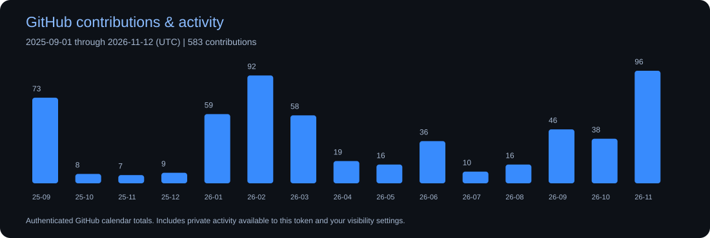
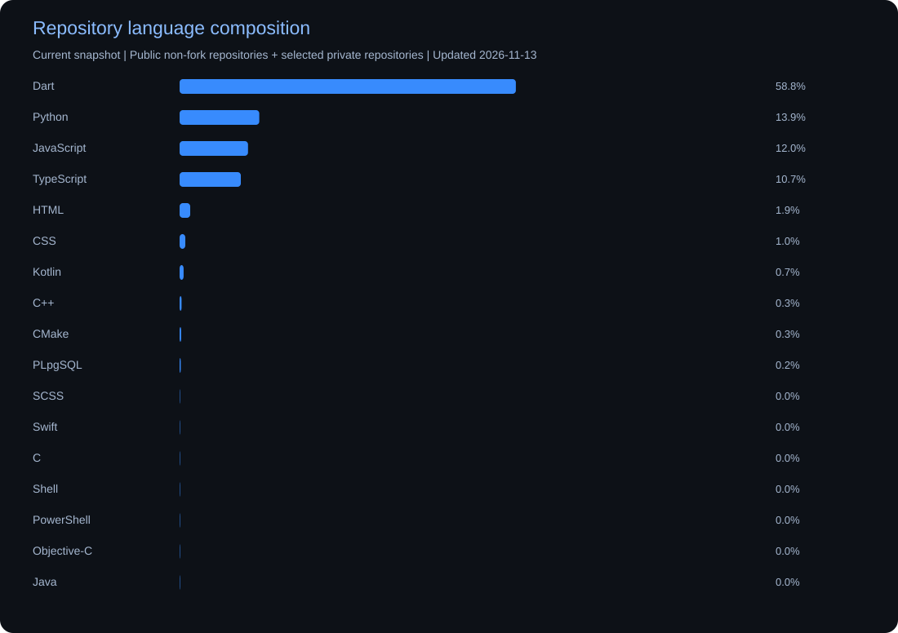
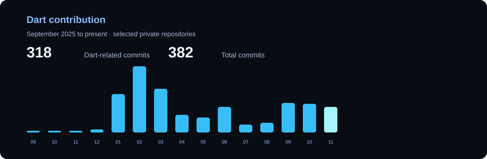

## About me

I build mobile and web applications, connecting user-facing interfaces with authentication, data, and backend services. I work with Dart and Flutter, React Native, React, and Next.js, with Firebase and Supabase for backend integration.

Currently building a mobile learning application with lessons, interactive quizzes, audio content, and saved progress. Available for freelance mobile and web development.

## Technologies I work with

  

  Dart · Flutter · React Native · React · Next.js · Firebase · Supabase

## GitHub contributions & activity

Calendar totals include private activity available to the authenticated account and its visibility settings. This date range differs from the rolling last-year calendar on GitHub. Private commit counts are not added again to these totals.

## Languages across my repositories

Current repository language composition, measured by code bytes—not proficiency, personal authorship, or language-specific contribution totals for the date range. Private repository names and code are not published in the chart.

Dart activity counts authored commits touching Dart files in the selected repositories' default-branch histories. It is a separate measure, not an additional GitHub contribution total.

## Currently building

### Mobile Learning Application

A mobile application bringing lessons, interactive quizzes, audio content, and saved progress into one learning experience.

Status: In development.

## Work & connect

[Explore my repositories](https://github.com/mohammedsharjun?tab=repositories) · [View activity on GitHub](https://github.com/mohammedsharjun?tab=overview)

Portfolio: Coming soon.

Charts are generated in this repository from GitHub API data. Coverage depends on token access, repository history, visibility settings and the measure described above.
